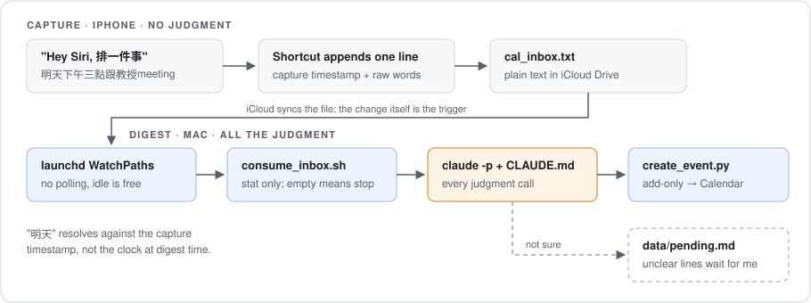

# CalAgent

[繁體中文](README.zh-TW.md)

**Say one sentence to Siri. About fifteen seconds later it is an event in the right calendar, with an end time you never mentioned.**

CalAgent is the calendar counterpart to [CountAgent](https://github.com/seanlu2006/CountAgent), and it splits the work the same way. The phone does nothing clever. A headless Claude on my Mac makes every judgment call.



## Why not just use Siri

Siri already creates events. Tell it "dentist, 3pm tomorrow" and it does the job. It breaks on the way I actually talk:

| What I say | What Siri wants | What's actually correct |
|---|---|---|
| 這禮拜五要交資料庫報告 | a clock time | an all-day event |
| 下週三晚上跟阿明吃飯 | "晚上" is not a time | 19:00, and dinner runs 90 minutes |
| anything at all | one default calendar | 學校 / 工作 / 個人 |

No regex fixes that. Each line is a judgment call: what kind of thing is this, how long does it usually take, where does it belong.

## How it works

**Capture, deliberately stupid.** An iOS Shortcut appends one line to a text file in iCloud, then stops. The line is a timestamp plus whatever I dictated. There are no fields to fill and nothing to configure.

**Digest, where the judgment lives.** launchd notices the file change and starts a headless Claude in this repo. It reads `CLAUDE.md`, works out what each line means, and writes events through a script that can only add. The rules are 264 lines of Chinese prose, not a parser, so changing the behaviour means editing a sentence.

## Where this had to diverge from CountAgent

An expense can sit in the inbox for three days and the ledger comes out identical. A calendar entry cannot. If the meeting reaches the calendar after the meeting, the agent was asleep at exactly the moment it was supposed to help.

So digestion does not wait for me to open a laptop. The launchd job uses `WatchPaths`, which fires on the file change itself rather than polling; in testing it fired within five seconds of the line landing. While the Mac is asleep the lines wait in iCloud, and when it wakes, the watcher or a 30-minute fallback timer picks them up.

## Anchoring relative time

Here is the bug this architecture invites.

Friday evening I say "明天早上十點打工". If the Mac is shut, that line might not be digested until Sunday. By then "tomorrow" resolves to Monday, and the shift was Saturday.

Every captured line therefore carries its capture timestamp, and every relative date resolves against that timestamp instead of the clock at digest time. It is one action in the Shortcut and one paragraph in the rules. Leaving it out would have produced events that look perfectly reasonable and are silently one day wrong.

## Guardrails

Appending a bad row to a CSV is an annoyance. Writing a bad event into a calendar while nobody is watching is a different kind of mistake, so the unattended run is deliberately timid:

- **Add only, enforced by permissions.** The headless run can read files, run `date`, run exactly two scripts (one adds an event, one reads the calendar), and edit files under `data/` plus the inbox. Nothing else. I checked by asking it to modify the add script and to run raw `osascript`. Both were refused, and the script's hash did not change.
- **Ambiguity means stop.** A line it cannot parse with confidence moves to `data/pending.md` and waits for me, so I am asked about it once instead of on every run. Missing an event is recoverable; a confidently wrong start time is not.
- **No backdating.** If the resolved time has already passed, the line goes to pending instead of the calendar.
- **Conflicts block the write** when the new event overlaps one in the same calendar. Overlaps across calendars are not checked yet.
- **Ten events per run**, so a sync glitch that replays hundreds of old lines cannot spray the calendar. This one is a rule in `CLAUDE.md`, not a hard limit in code.

Every created event is logged with its calendar UID. `scripts/undo_event.py` removes anything the agent made and cannot touch anything it didn't.

## Testing the rules on an agent that had never seen them

Since the rules are prose, the real test is whether a model with no other context can follow them. I seeded the inbox with seven lines, each aimed at a known trap, and gave a fresh agent nothing but this repo.

It created two events and correctly held back three: a line with no time in it, an expense that had landed in the wrong inbox, and a dentist visit that had already happened. The other two should have gone through. Both were a weekday said after that weekday had passed. Captured on a Saturday evening, "這禮拜五要交資料庫報告" could mean the Friday just gone or the next one, and the rules never said which.

Its report listed four ambiguities, and all four were real. The weekday fix is a rule people apply without noticing: nobody schedules something that already happened, so a weekday resolves to the next one still ahead. A second fresh agent, given the corrected rules, created both.

## What I measured

Calendar.app's AppleScript `whose` query walks every event in a calendar without an index. That is fine until a calendar has years of history in it:

| Query | Time |
|---|---|
| Conflict check (one calendar, one-hour window) | 0.8s |
| One day, across calendars | 14s |
| Seven days, across calendars | 99s |

EventKit would solve this, but a bare Python process gets no calendar permission from macOS; the request came back denied in 0.04 seconds without ever showing a prompt. Getting one would mean shipping the script inside an `.app` bundle with its own `Info.plist`. The write path is the one that runs unattended, and it already finishes in under a second. The slow query only runs when I ask to see my week, so it stays as it is, and `--calendar` narrows it when I want it quick.

## Getting a launchd job past TCC

This was the hard part.

A process that launchd spawns is its own responsible process as far as TCC is concerned, so the Full Disk Access I had granted Terminal did nothing for it. The failure is quiet. `test -f` passes and `ls` prints the file size; only reading the contents returns `Operation not permitted`. My first version counted lines, got zero, decided the inbox was empty and exited 0. It did that four times before I noticed, because I had sent the error to `/dev/null`.

The obvious fix is to give `/bin/bash` Full Disk Access. I didn't, because that lets every shell script on the machine read Mail, Messages and browser data. Instead the shell only calls `stat`, which needs no grant and is enough to decide whether to wake Claude at all. The contents are read by the Claude CLI, the one binary that holds the grant.

Two more walls came after that:

- The inbox sits outside the working directory, so the CLI's own file tools asked for approval that nobody was there to give. Passing the inbox folder to `--add-dir` settled it.
- The first unattended call to Calendar.app returned `-1712`, an AppleEvent timeout. The default limit is 60 seconds, and a cold Calendar.app loading every subscribed calendar can take longer when launchd starts it. The scripts now wait up to 300 seconds. Every run since has gone through, though two runs are not proof that the timeout was the whole story.

## Setup

1. Build the Shortcut: [`shortcut/SETUP.md`](shortcut/SETUP.md)
2. Install Claude Code, then run `claude` once to log in:
   ```bash
   curl -fsSL https://claude.ai/install.sh | bash
   ```
3. Give the CLI Full Disk Access: System Settings → Privacy & Security → Full Disk Access → `+` → ⌘⇧G → `~/.local/bin/claude`. Without it, the digest wakes up and reads nothing.
4. Create the inbox file, then load the watcher. `WatchPaths` needs the file to exist when the job loads, so the `touch` matters. The plist assumes the repo lives at `~/Projects/CalAgent`, and the `sed` swaps in your home directory:
   ```bash
   touch ~/Library/Mobile\ Documents/iCloud~is~workflow~my~workflows/Documents/cal_inbox.txt
   sed "s|/Users/sean|$HOME|g" launchd/com.sean.calagent.plist > ~/Library/LaunchAgents/com.sean.calagent.plist
   launchctl load ~/Library/LaunchAgents/com.sean.calagent.plist
   ```

Skip steps 2 to 4 and the capture side still works. Lines pile up in the inbox, and CalAgent digests them the next time you open this repo in Claude Code and ask.

## Files

```
CLAUDE.md                the rules; every judgment call lives here
scripts/create_event.py  the only thing that writes to the calendar, and it only adds
scripts/undo_event.py    removes events the agent created, by UID
scripts/list_events.py   read-only queries
scripts/consume_inbox.sh what launchd runs, including the permission allowlist
launchd/                 the file watcher
shortcut/SETUP.md        building the iPhone side
data/                    runtime logs, git-ignored; only *.example files are tracked
```

`Python` · `AppleScript` · `launchd` · `Claude Code`
