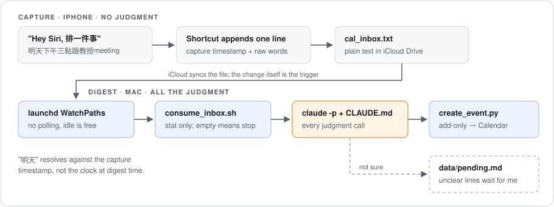

# CalAgent

[English](README.md)

**對 Siri 講一句話。大約十五秒後，它就是行事曆裡的一件事：放在對的那一本，還補上你根本沒講的結束時間。**

CalAgent 是 [CountAgent](https://github.com/seanlu2006/CountAgent) 的行事曆版，分工切在同一個地方。手機那端什麼聰明事都不做。所有判斷，交給我 Mac 上的一個 headless Claude。



## 為什麼不直接用 Siri

Siri 本來就會建行程。「明天下午三點看牙醫」它處理得很好。問題是我平常不那樣講話。

| 我會講的 | Siri 要的 | 正確答案 |
|---|---|---|
| 這禮拜五要交資料庫報告 | 幾點 | 全天事件，不要塞鐘點 |
| 下週三晚上跟阿明吃飯 | 「晚上」不是時間 | 19:00，而且吃飯要抓 1.5 小時 |
| 講什麼都一樣 | 一個預設行事曆 | 學校 / 工作 / 個人 分開 |

這不是寫個更好的 regex 就能解決的。每一行都是判斷題：這是哪一類、通常要多久、該放哪。

## 怎麼運作

**捕捉端，笨到極點。** iPhone 捷徑把一行字附加進 iCloud 的文字檔，然後就結束了。那行只有時間戳和我說的原話。沒有欄位，也沒有要設定的東西。

**消化端，判斷力都在這。** launchd 發現檔案變了，在這個資料夾裡叫起一個 headless Claude。它讀 `CLAUDE.md`，想清楚每一行是什麼意思，再交給一支只會新增的腳本寫進行事曆。規則是 264 行中文，不是 parser。要改行為，就是改一句中文。

## 和 CountAgent 非得不一樣的地方

一筆帳在收件匣躺三天，帳本結果一模一樣。行程不行。開會時間過了才進行事曆，等於這個 agent 在最該幫忙的那一刻是睡著的。

所以消化不能等我回電腦。launchd 用 `WatchPaths`，檔案一變動就觸發，不是輪詢。實測那一行落地後，五秒內就觸發了。Mac 睡著時，那些行就在 iCloud 等著。醒來後，由檔案監看或每 30 分鐘一次的保險計時器接手。

## 相對時間錨在哪

這個架構會引來一個很陰險的 bug。

禮拜五晚上我說「明天早上十點打工」。如果 Mac 關著，這行可能禮拜天才被消化。那時算「明天」會算成禮拜一，但班是禮拜六的。

所以每一行都帶著自己的捕捉時間戳。所有「明天」「下週三」一律對著那個時間戳換算，不是對著消化當下的時鐘。捷徑裡多一個動作，規則裡多一段話。少了它，建出來的事件看起來完全合理，就是默默錯一天。

## 護欄

CSV 多一列爛資料是麻煩。趁沒人看著的時候往行事曆寫錯東西，是另一個等級的問題。所以無人監督那條路刻意做得很膽小。

- **只新增，由權限保證。** 無人監督的那一輪可以讀檔、可以跑 `date`、只能跑兩支腳本（一支新增事件、一支唯讀查詢），能編輯的只有 `data/` 底下和收件匣。其他一律不行。我實際叫它去改那支新增腳本、去跑任意 `osascript`，兩件都被拒絕，腳本的雜湊值也沒變。
- **看不懂就停。** 沒把握的行搬進 `data/pending.md` 等我。同一行只會問我一次，不會每輪重問。漏建一件我補得回來，建錯時間我會直接錯過。
- **不補過去的事。** 換算出來的時間已經過了，就進 pending，不進行事曆。
- **撞行程擋下來。** 跟同一本行事曆裡的事件重疊，就不寫。跨行事曆的重疊目前還沒檢查。
- **一次最多十件。** iCloud 同步出錯、把幾百行舊資料倒回來時，行事曆不會被灌爆。這條是 `CLAUDE.md` 裡的規則，程式裡沒有硬上限。

每一件建出來的事都記下 UID。`scripts/undo_event.py` 撤得掉 agent 建過的任何事，也碰不到不是它建的。

## 拿一個沒看過規則的 agent 來考

規則是用中文寫的，所以真正的考驗是：一個沒有任何其他上下文的模型，照著做得對不對。我在收件匣放了七行，每一行都瞄準一個已知的坑。然後只給一個全新的 agent 這個資料夾。

它建了兩件，正確地擋下三件：一行沒有任何時間、一筆丟錯檔的帳、一次已經過去的看牙醫。另外兩件本來該建的。兩件都是「那個星期幾已經過了才講」。禮拜六晚上說「這禮拜五要交資料庫報告」，可以是昨天那個週五，也可以是下一個，而規則沒講是哪個。

它的回報列了四個歧義，四個都是真的。星期幾那條的修法，是人講話時根本不會意識到的規則：沒有人會排一件已經發生的事。所以星期幾一律往未來找最近的那一個。換上修好的規則後，第二個全新的 agent 兩件都建了。

## 量出來的數字

Calendar.app 的 AppleScript `whose` 查詢會逐筆掃過整本行事曆，不走索引。行事曆累積幾年歷史之後就開始痛：

| 查詢 | 耗時 |
|---|---|
| 衝突偵測（單一行事曆，一小時窗） | 0.8 秒 |
| 一天，跨行事曆 | 14 秒 |
| 七天，跨行事曆 | 99 秒 |

EventKit 可以解決這個問題。但裸的 Python 程序拿不到 macOS 的行事曆權限：請求 0.04 秒就被拒，連對話框都沒跳。要拿到權限，就得把腳本包成 `.app`、自己帶 `Info.plist`。無人監督跑的是寫入那條路，而它已經不到一秒。慢的查詢只有我主動想看這禮拜有什麼時才會跑，所以就讓它慢著。想快就用 `--calendar` 指名一本。

## 讓 launchd 過 TCC 這關

這是整個專案最難的一段。

對 TCC 來說，launchd 生成的程序自己就是 responsible process。所以我給終端機的完全取用磁碟，對它沒用。失敗的樣子很安靜。`test -f` 會過，`ls` 印得出檔案大小，只有真的讀內容才回 `Operation not permitted`。第一版數行數、數到 0，判定收件匣是空的，然後 exit 0。它這樣跑了四次我才發現，因為我把錯誤丟進了 `/dev/null`。

最直覺的修法是給 `/bin/bash` 完全取用磁碟。我沒這樣做。那會讓這台機器上每一支 shell 腳本，都能讀 Mail、Messages 和瀏覽器資料。改成讓 shell 只呼叫 `stat`：它不需要任何授權，而且已經夠判斷要不要叫醒 Claude。內容交給 Claude CLI 自己讀，它是唯一拿到授權的 binary。

後面還有兩道牆：

- 收件匣在工作目錄外，CLI 自己的檔案工具會要求核准，而當下沒有人能核准。把收件匣那個資料夾加進 `--add-dir` 就解決了。
- 第一次無人監督地呼叫 Calendar.app，回了 `-1712`，也就是 AppleEvent 逾時。預設上限是 60 秒。從 launchd 叫起一個冷的 Calendar.app、再載完所有訂閱行事曆，可能超過。腳本現在最多等 300 秒。之後每一輪都順利跑完，不過兩輪還不足以證明逾時就是全部原因。

## 安裝

1. 建捷徑：[`shortcut/SETUP.md`](shortcut/SETUP.md)
2. 裝 Claude Code，再跑一次 `claude` 登入：
   ```bash
   curl -fsSL https://claude.ai/install.sh | bash
   ```
3. 給 CLI 完全取用磁碟：系統設定 → 隱私權與安全性 → 完全取用磁碟 → `+` → ⌘⇧G → `~/.local/bin/claude`。少了這步，消化會醒來，但什麼都讀不到。
4. 先建收件匣檔案，再載入監看器。`WatchPaths` 要求載入時檔案就存在，所以 `touch` 那行不能省。plist 預設這個 repo 放在 `~/Projects/CalAgent`，`sed` 會換成你的家目錄：
   ```bash
   touch ~/Library/Mobile\ Documents/iCloud~is~workflow~my~workflows/Documents/cal_inbox.txt
   sed "s|/Users/sean|$HOME|g" launchd/com.sean.calagent.plist > ~/Library/LaunchAgents/com.sean.calagent.plist
   launchctl load ~/Library/LaunchAgents/com.sean.calagent.plist
   ```

第 2 到 4 步沒做，捕捉端照樣能用。那些行會堆在收件匣，下次你在 Claude Code 打開這個資料夾說一聲「整理行程」，CalAgent 就會消化掉。

## 檔案

```
CLAUDE.md                規則；所有判斷都在這份檔案裡
scripts/create_event.py  唯一會寫進行事曆的東西，而且只會新增
scripts/undo_event.py    依 UID 撤銷 agent 建過的事件
scripts/list_events.py   唯讀查詢
scripts/consume_inbox.sh launchd 跑的就是這支，權限白名單也在裡面
launchd/                 檔案監看器
shortcut/SETUP.md        iPhone 那一端怎麼建
data/                    執行期的 log，不進版控；只追蹤 *.example 檔
```

`Python` · `AppleScript` · `launchd` · `Claude Code`
